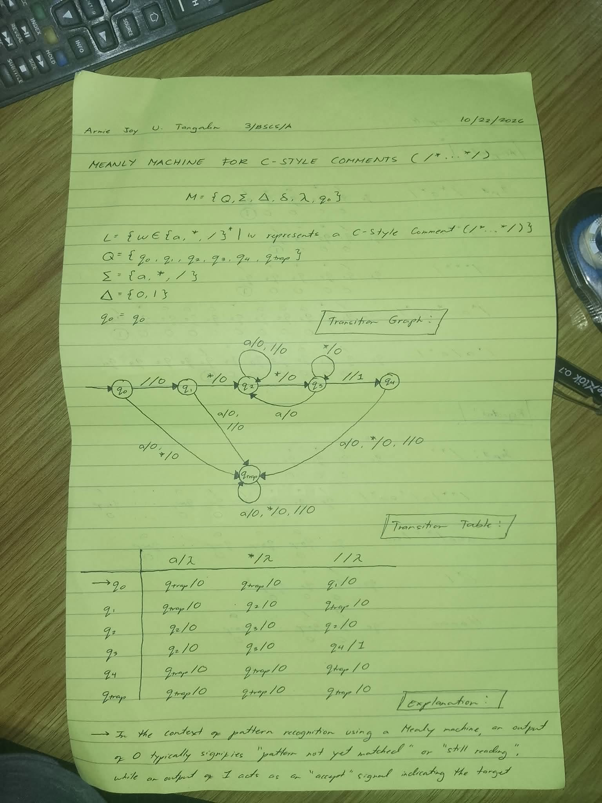
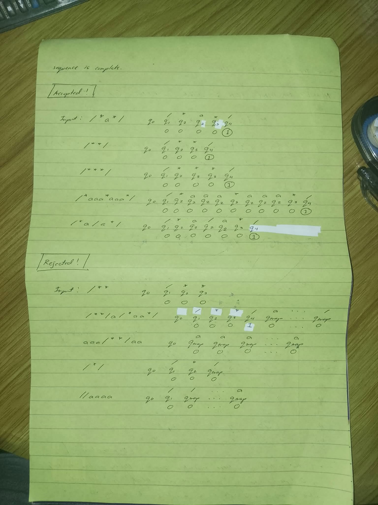

# Automata_Mealy-Machine Assignment

**Name:** Tangalin, Armie Joy U.
**Year/Course/Section:** 3/BSCS/A
**Subject** CS13a: Automata Theory & Formal Language
**Date:** 10/22/2026

## Description
This submission contains handwritten state transition traces for a finite automaton (likely evaluating C-style block comments) across various input strings.

### Front page

### Back page

